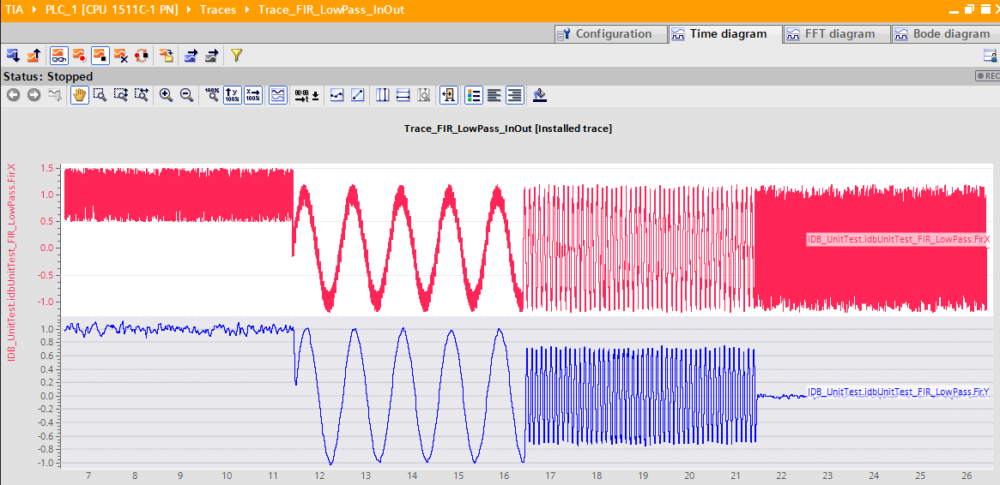

# TRMFIRLib

FIR low-pass filters for SIMATIC S7 PLCs, written in SCL and packed as a TIA Portal global library.

| Block | What it is | Use it when |
|---|---|---|
| `FB_FIR_LowPass` | Low-pass with adjustable cutoff (4 cascaded moving averages) | You need to smooth a noisy signal and want to choose the cutoff, roughly 0.23 Hz to 20 Hz |
| `FB_FIR_LP100` | Low-pass with fixed 100 Hz cutoff (17 taps, Blackman-windowed sinc) | You need a sharp, fast filter with only 8 ms delay |
| `UnitTest_FIR_LowPass`, `UnitTest_FIR_LP100` | Self-checking tests for the two filters | Optional, see [Unit tests](#unit-tests) |

Both filters have linear phase (every frequency is delayed by the same time) and a DC gain of 1 (a constant input comes out unchanged).



*`FB_FIR_LowPass` with `Fc_Set = 10.0`. Top: input `X`. Bottom: output `Y`. Four test signals of 5 s each: constant 1.0 with noise (noise is removed), 1 Hz sine with noise (passes unchanged), 10 Hz sine with noise (reduced to about 0.7 = -3 dB), 66 Hz sine with noise (removed).*

## Requirements

- TIA Portal V21 or newer with STEP 7 (the library cannot be opened in older versions).
- Supported PLCs: S7-1500 and S7-1200. The blocks were compiled and tested only on an S7-1500 (CPU 1511C-1 PN, firmware 4.1). They use only `LReal` arithmetic and the `RUNTIME` instruction.
- On an S7-1200 mind the work memory: one `FB_FIR_LowPass` instance takes about 32 KB. See [Memory](#fb_fir_lowpass) for how to reduce it.
- Both filters are designed for a call interval of **1 ms**. See [Call interval](#call-interval) if your cycle is different.

## Getting the blocks into your project

1. On GitHub press **Code > Download ZIP** and unpack the archive anywhere on your PC.
2. In TIA Portal open your project, then open the **Libraries** task card on the right side.
3. In the **Global libraries** pane press **Open global library**, browse to the unpacked folder and select `TRMFIRLib.al21`. Leave **Open as read-only** checked.
4. Expand **TRMFIRLib > Master copies**.
5. Drag a master copy onto **Program blocks** of your PLC. The filter block comes along with it.
6. If you do not use the unit tests, delete the `UnitTest_...` block from your project. The filter block stays and works on its own.

## Example call

Call the filter exactly once per cycle, without any condition around the call. The block measures the time between two calls itself.

Declare an instance, either as a static variable of your own FB (shown here) or as a separate instance DB:

```scl
VAR
    PressureFilter : "FB_FIR_LowPass";
END_VAR
```

Call it:

```scl
#PressureFilter(Enable := TRUE,
                Reset  := FALSE,
                X      := "DB_Process".PressureRaw,       // noisy value
                Fc_Set := 5.0,                            // cutoff in Hz
                Y      => "DB_Process".PressureFiltered); // smoothed value
```

`FB_FIR_LP100` is called the same way, only without `Fc_Set`:

```scl
#VibrationFilter(Enable := TRUE,
                 Reset  := FALSE,
                 X      := "DB_Process".VibrationRaw,
                 Y      => "DB_Process".VibrationFiltered);
```

Things to know:

- `Enable` is `FALSE` by default. If you do not set it to `TRUE`, the output never changes.
- `X` and `Y` are `LReal`. A `Real` tag can be connected directly. Convert an integer value first, for example `X := INT_TO_LREAL("AnalogIn")`.
- In LAD or FBD, drag the FB from the project tree into a network and connect the same parameters.
- All inputs other than `Enable` and `X` may be left unconnected. All outputs other than `Y` are diagnostics and may be left unconnected.

## FB_FIR_LowPass

Four moving averages in a row, each over `M` samples. The block picks `M` from `Fc_Set`. Computing time is the same for any cutoff, because every stage keeps a running sum. There is no overshoot on a step.

**Inputs**

| Name | Type | Default | Meaning |
|---|---|---|---|
| `Enable` | Bool | FALSE | TRUE = filter runs. FALSE = `Y` keeps its last value. |
| `Reset` | Bool | FALSE | TRUE = restart. The filter is filled with the current `X`, so `Y = X` with no start-up ramp. |
| `X` | LReal | 0.0 | Input sample. |
| `Fc_Set` | LReal | 1.0 | Requested -3 dB cutoff in Hz. Changing it restarts the filter (`Y` jumps to `X`). |
| `Ts_Limit` | LReal | 0.01 | In seconds. A measured call interval longer than this (for example a communication peak) is ignored for the cycle measurement. |
| `Ts_Tol` | LReal | 0.05 | Allowed deviation of the average call interval from 1 ms before `Ts_Drift` is set (0.05 = 5 %). |

**Outputs**

| Name | Type | Meaning |
|---|---|---|
| `Y` | LReal | Filtered value. |
| `M_Act` | Int | Window length of each stage in samples. |
| `Fc_Eff` | LReal | Cutoff really in effect in Hz, for `M_Act` and the measured cycle. |
| `Delay` | LReal | Delay of the output against the input in seconds. |
| `Ts_Meas` | LReal | Average call interval in seconds, averaged over about 1 s. |
| `Ts_Valid` | Bool | TRUE = the interval measured in this call was plausible. |
| `Ts_Drift` | Bool | TRUE = the average call interval differs from 1 ms by more than `Ts_Tol`. The cutoff is then not what you set, read `Fc_Eff`. |

**Choosing the cutoff** (at a 1 ms call interval)

| `Fc_Set` | `M_Act` | `Fc_Eff` | `Delay` |
|---|---|---|---|
| 0.23 Hz | 990 | 0.23 Hz | 1.98 s |
| 1 Hz | 228 | 1.00 Hz | 0.45 s |
| 5 Hz | 46 | 4.95 Hz | 90 ms |
| 10 Hz | 23 | 9.90 Hz | 44 ms |
| 20 Hz | 11 | 20.7 Hz | 20 ms |

- `M = 0.2276 / (Fc_Set * 0.001 s)`, rounded and limited to 1 ... 1000. Because `M` is a whole number, `Fc_Eff` differs slightly from `Fc_Set`, more so at high cutoffs.
- A lower cutoff smooths more and delays more: `Delay` is about `0.45 / Fc`.
- Frequencies above `4.4 * Fc_Eff` are damped by at least 53 dB (a factor of about 450).
- `Fc_Set` below 0.23 Hz (also 0 or negative) gives the lowest possible cutoff, `M = 1000`.
- Above about 20 Hz the filter gets coarse, and at 228 Hz and more `M = 1`, which means no filtering.

**Memory:** about 32 KB of work memory per instance (4 buffers of 1000 `LReal`). To reduce it, open the block in your project and lower the constant `M_MAX` and the second bound of the static array `Buf` (always `M_MAX - 1`) together. The lowest cutoff rises accordingly: `M_MAX = 250` needs about 8 KB and reaches down to 0.91 Hz.

## FB_FIR_LP100

Classic FIR filter with 17 fixed coefficients. At a 1 ms call interval: -3 dB at 100 Hz, -60 dB from 287 Hz, below -72 dB from 300 Hz to 500 Hz. Delay 8 samples = 8 ms.

**Inputs**

| Name | Type | Default | Meaning |
|---|---|---|---|
| `Enable` | Bool | FALSE | TRUE = filter runs. FALSE = `Y` keeps its last value. |
| `Reset` | Bool | FALSE | TRUE = clear the stored samples and set `Y` to 0. |
| `X` | LReal | 0.0 | Input sample. |
| `Ts_Limit` | LReal | 0.01 | Same as in `FB_FIR_LowPass`. |
| `Ts_Tol` | LReal | 0.05 | Same as in `FB_FIR_LowPass`. |

**Outputs**

| Name | Type | Meaning |
|---|---|---|
| `Y` | LReal | Filtered value. |
| `Ts_Meas` | LReal | Average call interval in seconds, averaged over about 1 s. |
| `Ts_Valid` | Bool | TRUE = the interval measured in this call was plausible. |
| `Ts_Drift` | Bool | TRUE = the average call interval differs from 1 ms by more than `Ts_Tol`. |
| `Fc_Eff` | LReal | Cutoff really in effect in Hz: `100 Hz * 0.001 s / Ts_Meas`. |

- This filter starts from zero. After power-up or `Reset`, `Y` needs 17 calls to reach the input level.
- Do not change the static array `Coef` online. It holds the filter coefficients.

**Memory:** about 0.5 KB per instance.

## Call interval

A digital filter only has the stated cutoff if it gets one sample at a fixed interval. Both blocks are designed for 1 ms (constant `TS_DESIGN` in the block interface).

- Call the block in an OB that runs every 1 ms. That is OB1 if its cycle is a steady 1 ms (the blocks were tested this way), otherwise a cyclic interrupt OB with a cyclic time of 1 ms.
- Never skip calls and never call an instance twice per cycle. Use `Enable` to pause the filter.
- The block measures the real interval and reports it in `Ts_Meas`. If it is not 1 ms, `Ts_Drift` becomes TRUE and `Fc_Eff` shows the cutoff you really get. A single long cycle does not disturb this, only a lasting deviation does.
- Other interval with `FB_FIR_LowPass`: open the block in your project and set the constant `TS_DESIGN` to your interval in seconds. The usable cutoff range moves with it, for example 0.023 Hz to 2 Hz at 10 ms.
- Other interval with `FB_FIR_LP100`: the cutoff is always one tenth of the call rate, for example 50 Hz at 2 ms. Leave `TS_DESIGN` unchanged, so that `Fc_Eff` shows the right value.

## Unit tests

`UnitTest_FIR_LowPass` and `UnitTest_FIR_LP100` feed the filter with the four signals shown in the picture above and check the output against limits (DC gain, noise reduction, passband, -3 dB point, stopband).

They need a unit test framework that is **not part of this library**: the blocks `BeforeEach`, `AfterEach`, `assertTrue` and the data block `DB_UnitTestControl`. Without these the test blocks do not compile. The filters do not need them, so delete the test blocks if you do not have the framework.

## Repository contents

| Path | Content |
|---|---|
| `TRMFIRLib.al21` | Library file, open this one in TIA Portal |
| `System/`, `Vci/`, `LibraryInfo.txt` | Library data, managed by TIA Portal, do not edit |
| `MovingAverage10Hz.PNG` | Trace shown above |
| `LICENSE` | Licence text |

## AI disclosure

Most of the code in this library (filter blocks and unit tests) and this README were generated with AI assistance. The README was drafted with Claude (Anthropic). The author reviewed the result, compiled it and ran the included unit tests on an S7-1500. Test the blocks in your own application before you rely on them.

## Licence

MIT, see [LICENSE](LICENSE). You may use, change and redistribute the blocks, also commercially, as long as the copyright notice stays. The software comes without any warranty.
